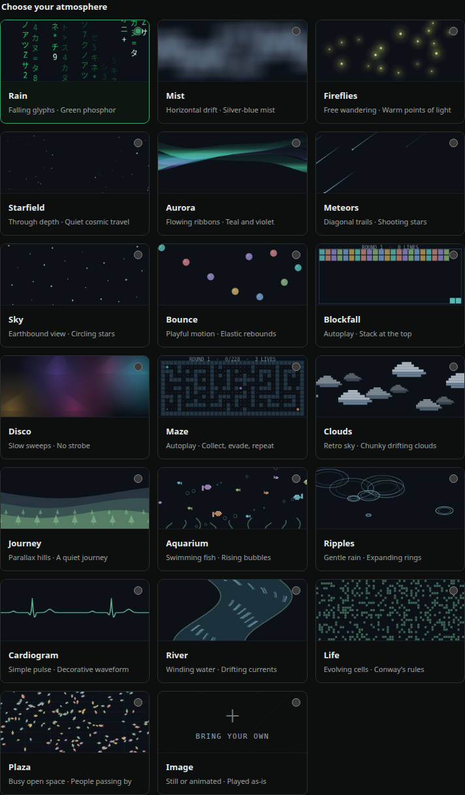
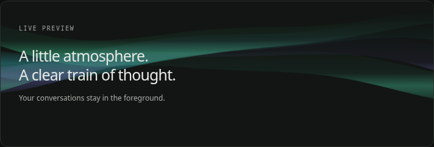
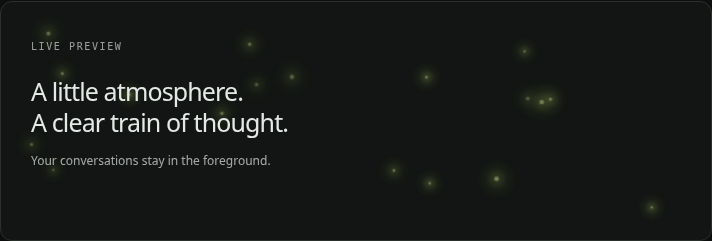
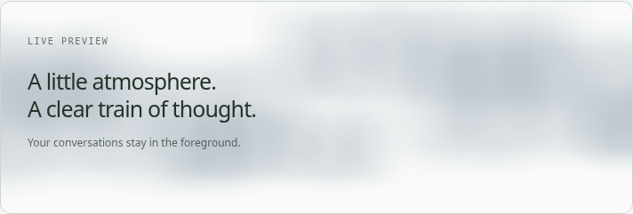
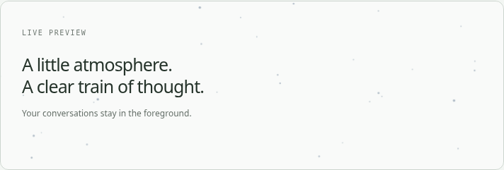
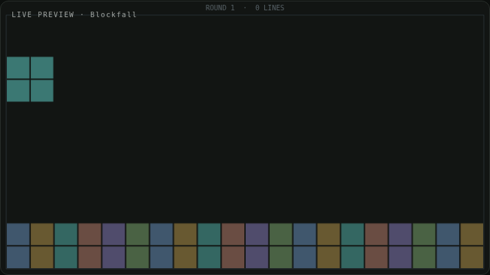
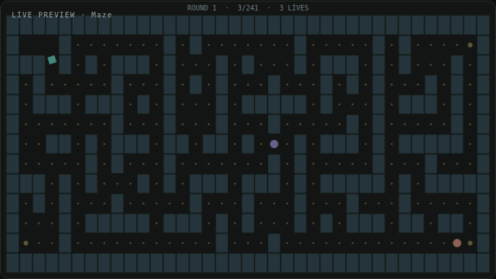
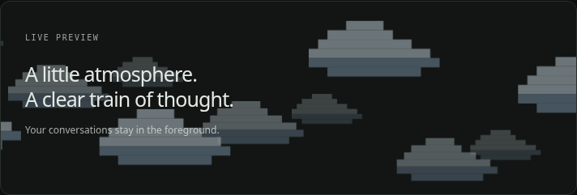
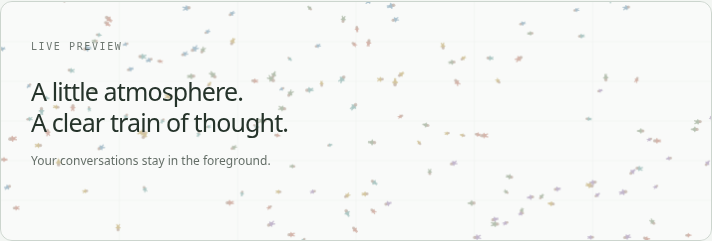

# Conversation wallpaper for OpenCode Desktop

A small collection of animated atmospheres and local image backgrounds, behind conversations only.

[Install](#install) · [Upgrade an existing installation](#upgrade-an-existing-installation) · [Development](#development)



## The collection

| Wallpaper | Its motion |
| --- | --- |
| **Rain** | Green glyphs falling downward |
| **Mist** | Soft silver-blue clouds drifting horizontally |
| **Fireflies** | Warm glowing particles wandering freely |
| **Starfield** | Quiet travel through depth, stars moving outward |
| **Aurora** | Teal and violet ribbons flowing and undulating |
| **Meteors** | Shooting stars tracing diagonal trails |
| **Sky** | Stars circling a fixed celestial pole, as viewed from Earth |
| **Bounce** | Colorful balls rebounding off the edges |
| **Blockfall** | An inverted block puzzle: pieces rise from below, stack at the top, clear lines, and repeat |
| **Disco** | Colored spotlights and soft beams sweeping slowly—no strobing |
| **Maze** | An autonomous maze match: collect, evade sentries, finish, and play a new maze |
| **Clouds** | Chunky retro clouds drifting horizontally in three parallax layers |
| **Journey** | Trees and hills scrolling past at different depths |
| **Aquarium** | Small pixel fish swimming independently, with bubbles and swaying plants |
| **Ripples** | Expanding, fading rings from occasional raindrops |
| **Cardiogram** | A simple repeating pulse scrolling across the screen |
| **River** | Currents following a winding river channel |
| **Life** | A living cell grid evolving under Conway’s B3/S23 rules |
| **Plaza** | A busy open space with many small people walking in and out |
| **Image** | A still or animated local image, displayed as-is |

Each built-in wallpaper defines its own movement; there is no direction control. Select one from the gallery,
adjust dimming and animation speed, or pause it. Gallery thumbnails are stills, not extra animation loops.
Names are deliberately short and unique. The single-word labels introduced in v0.4.1 do not change saved wallpaper
selections, preferences, or uploaded images; only display names changed. **Mist** is the soft cloud effect; **Clouds** is retro.

### A few moods

| Aurora · dark theme | Fireflies · dark theme |
| --- | --- |
|  |  |
| **Mist · light theme** | **Starfield · light theme** |
|  |  |

| Blockfall · autonomous puzzle | Maze · autonomous match |
| --- | --- |
|  |  |

| Clouds · retro sky | Plaza · light theme |
| --- | --- |
|  |  |

These are real renderer captures from the mock desktop test layout, paused for screenshots—not screenshots of a live
OpenCode Desktop installation. Your theme, fonts, and dimming setting may look different. All nineteen built-ins animate.

**Life** implements Conway’s Game of Life, with toroidal edge wrapping and smoothly blended generations. Dead,
short-cycling, or long-running worlds fade into fresh seeds so it remains interesting indefinitely. Evolution freezes
when paused or hidden and does not reset merely because the conversation is resized.

**Plaza** uses 180–360 small procedural people, with varied coats, walking gaits, speeds, and routes. They enter
and leave beyond the edges of the available space. This is a lightweight decorative crowd, not collision-aware crowd
simulation. **Cardiogram** is a decorative pulse only, not a medical monitor or a display of actual vital signs.

### Games that keep playing

**Blockfall** plans legal placements, clears complete rows, and fades into another round when blocked or after a bounded
45-piece round. Its board is displayed upside down: pieces rise from the bottom and accumulate at the top, keeping the
lower reading area clearer. Only the board is flipped; score text stays upright. **Maze** generates an original connected maze. A diamond courier collects the board,
uses temporary shields, and avoids two circular sentries. It has three lives, win/loss states, and a fresh maze after each
match; a 90-second simulated-time limit prevents stalled rounds. Both play autonomously and repeat indefinitely.

These are original decorative simulations, not interactive games or branded reproductions. They do not capture keys,
clicks, or conversation content, and have no audio. Pausing, reduced motion, or hiding the conversation freezes the game
clock too—there is no invisible background match progressing while you are away. Resizing does not reset a round.

Both games fill the conversation's available width and height, with only a small edge inset and compact score row—no
fixed-size centered mini-board. Blockfall adapts its grid and reflows its top-displayed stack as the room changes.
Maze scales the current match immediately, then generates a grid suited to the new aspect ratio at the next round.

## Features

- Built-in green digital rain, enabled by default at 55% dimming with smooth movement between cells.
- Import a local PNG, JPEG, GIF, WebP or AVIF (up to 8 MB). PNG/WebP animations are supported when Chromium decodes them.
- Image fill/contain, dimming, built-in animation speed from **0.2× to 4×**, and pause controls with a live preview.
- Uploaded stills stay still; animated GIF/WebP/PNG files play their own embedded animation. No artificial panning,
  particles, or other motion is added, and speed controls are hidden for uploads.
- Animated images are frozen using a canvas snapshot, not an ineffective CSS animation pause.
- Honors system reduced motion by default, with an explicit opt-out. Built-ins stop and images freeze when the timeline or app document is hidden.
- Live preview status explains pauses and reports actual painted frames. A **Make wallpaper more visible** preset sets 40% dimming and 1.2× speed.
- Canvas effects capped at 24 fps and 2× pixel density. Cloud and firefly glow textures are cached; particle counts are bounded.
- Nineteen atmospheres spanning retro scenery, nature, space, autonomous games, cellular evolution, a decorative pulse, and a busy crowd.
- Clouds, fireflies, and stars automatically adapt to the app's light or dark appearance. Light mode uses blue-gray mist,
  amber fireflies, and ink-blue stars; the original dark palettes are preserved. Paused wallpapers and gallery thumbnails
  repaint when you switch themes, while uploaded images keep their original colors.
- Settings persist across sessions and apply to all workspaces. No model calls, remote image requests, or uploads.
- Command-palette actions to open settings, hide/show wallpaper, and pause/resume animation.

## Install

Targets **OpenCode V2 Desktop**, developed against `@opencode/plugin` **2.2.2**. The GUI plugin API is experimental.

Already installed? Use [Upgrade an existing installation](#upgrade-an-existing-installation) instead of adding a second revision.

Run this on the **computer running OpenCode Desktop**, not only a remote workspace server:

```sh
opencode plugin add github:dluc/opencode-conversation-wallpaper
```

This uses OpenCode's standard Git-package installer and updates your global plugin configuration while preserving
other entries. The repository is private: your computer needs Git credentials with access to it (for example,
`gh auth login` followed by `gh auth setup-git`). An SSH alternative is:

```sh
opencode plugin add 'git+ssh://git@github.com/dluc/opencode-conversation-wallpaper.git#main'
```

The repository includes the prebuilt `dist/gui-experimental.cjs`. No local build or npm runtime dependencies are
required, and there are no installation-time scripts. `private: true` in `package.json` prevents accidental npm
publishing; it does not prevent installation from GitHub.

Alternatively, add the Git package to the existing `plugins` array in your **global**
`~/.config/opencode/opencode.jsonc` (or its existing `.json` equivalent):

```jsonc
{
  "$schema": "https://opencode.ai/config.json",
  "plugins": [
    "github:dluc/opencode-conversation-wallpaper"
  ]
}
```

OpenCode watches configuration changes. Look under **Settings → Conversation wallpaper**, or find
**Conversation wallpaper settings** in the command palette. GUI availability can also be checked under
**Settings → Extensions → Plugins**. This package has only a GUI entry; it adds no server tools or hooks.

Choose a built-in from the gallery, or **Image → Choose image…** to import a file.
Try 35–55% dimming if the effect is too faint; increase it for quieter reading.

## Upgrade an existing installation

**Use the CLI; no manual config editing is required.** First check the configured source:

```sh
opencode plugin list
```

If the wallpaper's `SOURCE` is already `github:dluc/opencode-conversation-wallpaper`, update it directly:

```sh
opencode plugin update 'github:dluc/opencode-conversation-wallpaper'
```

### One-time switch from a pinned installation

Earlier instructions used commit or release pins. `plugin update` does not move such a pin to a different release.
To switch to normal updates, remove the **exact SOURCE shown by `plugin list`**, then add the unpinned source.

For example, **only if your SOURCE ends in `#v0.2.1`**:

```sh
opencode plugin remove 'github:dluc/opencode-conversation-wallpaper#v0.2.1'
opencode plugin add github:dluc/opencode-conversation-wallpaper
```

If yours ends in `#v0.2.0`, an older commit hash, or another suffix, use that exact source in the remove command instead.
Do not add the new source until the old entry has been removed. The remove command changes configuration only—it does
not erase the plugin's stored settings or images. Other plugin entries are preserved. No service restart is needed.

Once `plugin list` shows the unpinned source, all future updates use:

```sh
opencode plugin update github:dluc/opencode-conversation-wallpaper
```

For SSH/`#main` installations, pass the entire SOURCE string instead. **No plugin updates available** is a normal result
when already current. The target must match exactly; an unqualified command does not match an entry ending in `#v0.2.1`.

OpenCode v2.2.2 also has a cold-inventory race: `plugin list` may initially be empty, and update/check may report
**Plugin is not configured** while the background service is still loading plugins. Wait until `plugin list` shows the
wallpaper, then retry using its exact source from the same working directory. Repeated failure after that needs separate
CLI/service investigation; do not delete app data or keep adding duplicate entries.

The CLI-only remove/add migration, preservation of unrelated config/comments, and a genuine old-to-new Git-branch upgrade
were tested with the native v2.2.2 Linux CLI using isolated config/data/cache/state. This is separate from the mock-host
browser tests below, not a macOS Desktop test.

To deliberately pin a release for reproducibility, new installations can use
`opencode plugin add 'github:dluc/opencode-conversation-wallpaper#v0.4.1'`. To change an existing pin, use the same remove/add
procedure with the exact old and new targets—not `plugin update` and not a second duplicate entry.

For local development, configure an absolute path to a clone of this repository instead of the Git package.
If you previously configured a local copy, remove that old entry before adding the Git package so only one copy loads.

### Updating from 0.1.0 / faint or static rain

Use the one-time CLI migration above if pinned, or update the exact source for a branch-tracking install.

In **Settings → Conversation wallpaper**, choose **Make wallpaper more visible**. Existing preferences are preserved
when updating, so an old 75% dimming setting does not change until you adjust it or use the preset.

The text below the preview tells you why motion is paused (manual pause, system Reduce motion, or hidden/offscreen),
or displays a count of actual painted frames. The original effect combined 75% dimming with already-translucent
glyphs, and moved in discrete grid steps; version 0.1.1 brightens the trails and moves them smoothly.

If the status reports your system's Reduce motion setting, leave it paused if that is your preference, or explicitly
turn off **Follow system Reduce motion** to animate this wallpaper without changing macOS accessibility settings.
**Pause animation** still always takes precedence. The brighter preset does not override system reduced motion.

If the preview animates but a conversation does not, report your Desktop version and whether dimming changes are visible
in the conversation. Do not remove theme overlays or lower message opacity to compensate; the host DOM adapter may need updating.

To disable the entire GUI, use its switch in **Settings → Extensions → Plugins**. To uninstall:

```sh
opencode plugin remove github:dluc/opencode-conversation-wallpaper
```

Use the exact configured source if yours differs. Alternatively, remove only this plugin's entry from your global
configuration. The extension removes its layers, styles, listeners,
observers, and animation frames when unloaded. Stored preferences/images may remain in app storage.

## Privacy and limitations

- Images are embedded in local app preferences as data URLs. They are not attached to prompts or sent to a model.
  App-data backups may contain the image. **Remove image** clears the current stored image, not old backups.
- SVG, HTML, external image URLs, and local filesystem URLs are deliberately not accepted.
- This extension never reads messages or composer text. Wallpaper layers ignore pointer events and are hidden from assistive technology.
- Reduced motion (unless explicitly opted out) and **Pause animation** override image animation. Resuming a GIF may restart it.
  Paused snapshots are capped at 2048 pixels on their longest edge to bound memory use.
- The documented `Style` API supplies CSS, but OpenCode does not offer a dedicated timeline-background slot.
  An isolated layout adapter finds `session-timeline-scroll` only when
  its parent also has the expected `session-timeline-visible` sibling. Unknown layouts are left untouched rather
  than painting the whole app. Future OpenCode releases may require an adapter update.
- Dimming changes wallpaper opacity only; it does not lower message opacity or replace theme colors.
- Large/high-resolution animated images can still be expensive to decode. Smaller images are recommended.

## Development

Use Node 22+ and npm. Dependencies are development-only. The checked-in `.npmrc` disables npm’s automatic
peer installation: the SDK exposes optional terminal/Electron peers that this GUI-only package does not need.
The Effect version matches the SDK exactly to avoid incompatible schema types.

```sh
npm ci
npm run check
npm run test:browser
npm audit
```

For browser tests, install Chromium with `npx playwright install chromium`, or set `CHROME_BIN` to an existing
Chromium executable. Tests start their own Vite server on port 4322 and close it afterwards.

```sh
npm run dev          # rebuild the GUI on changes; OpenCode reloads local GUI bundles
npm run preview:dev  # mock desktop UI at http://localhost:4321/preview/
```

Rebuild `dist/gui-experimental.cjs` with `npm run build:gui` after source changes. The GUI bundle is a single
CommonJS file with only OpenCode-provided runtime imports (`effect`, `solid-js`, and `@opencode/plugin/gui`).
Do not add install-time build scripts: the prebuilt package should be usable without registry access.

### Verification scope

Unit/DOM tests cover all nineteen renderers (motion, still frames, 4× speed, resizing), input restrictions, host detection,
hidden/paused/disabled states, animation cleanup, image snapshots/errors/removal, and late-mounted/cached timelines.
Chromium tests run the **real plugin setup and settings UI against a mock host**, checking every animation,
static gallery thumbnails, pause/resume, reduced motion, GIF import/freeze, unchanged still uploads, preserved uploads
when switching modes, built-in-only speed controls, file rejection, chat pointer/keyboard interaction, narrow layouts,
and unloading/reloading. Light-mode checks measure the canvas pixels composited over white at 55% dimming, including
theme changes while running and paused, and restoration of the original dark frames. Screenshots are saved
to ignored `test-results/`.

Simulation tests run multiple complete game rounds, check connected mazes, legal actor positions, row clearing,
board completion, lost lives, and automatic restarts. Browser checks also exercise game/non-game preview transitions,
tiny positive viewport sizes, and switching back to uploaded images in the larger gallery. Responsive-game tests inspect
actual Canvas playfield calls at landscape, portrait, and tiny sizes, checking full-area coverage and unchanged round
counters while a paused match is resized.
Cellular-automaton tests verify still lifes, blinkers, gliders, edge wrapping, bounded reseeding, and paused time. Crowd
tests verify bounded population and continuous movement through offscreen entry/exit points. The pulse is checked for
periodicity and its simple waveform shape.

These are not a live OpenCode Desktop installation test. Verify the plugin in your actual app version before
relying on compatibility. No global OpenCode configuration is modified by the tests or build.

Refresh the nine checked-in README images only after the browser checks succeed:

```sh
npm run docs:screenshots
```

Use the same `CHROME_BIN` override as the browser tests if Chromium is already installed. No external images or assets are downloaded.

To rerun the native CLI-only migration check, with Git credentials for this private repository:

```sh
npm run test:cli
```

Set `OPENCODE_TEST_BIN` to an absolute CLI executable path if `opencode` is not on PATH. The test uses fresh directories
under ignored `test-results/`, preserves Git credentials for downloading the private package, and stops only its own
isolated service. It never changes your active OpenCode configuration. It checks remove/add and update, not Desktop rendering.
